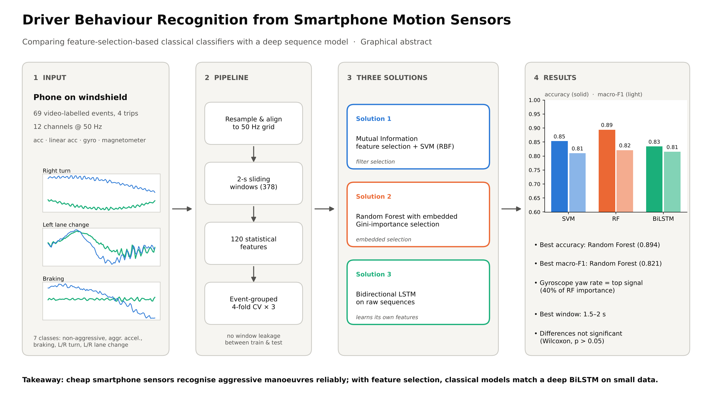

# Driver Behaviour Recognition from Smartphone Motion Sensors

**Pattern Recognition (PE-IV), MIT World Peace University, Final Year AI & DS, AY 2026-27**
Harshit Girish Seth (PRN 1032240161)

Recognising 7 driving events (non-aggressive, aggressive acceleration, braking, left/right turn, left/right lane change) from smartphone accelerometer, linear accelerometer, gyroscope and magnetometer data, and comparing three pattern recognition solutions.



## Three solutions
1. **Statistical time-domain features + Mutual Information feature selection + SVM (RBF kernel)**: filter feature selection (SelectKBest), with k tuned in nested CV
2. **Statistical time-domain features + Random Forest with embedded (Gini-importance) feature selection**: SelectFromModel, median threshold
3. **Bidirectional LSTM** on raw 12-channel sequences

## Results (event-grouped stratified 4-fold CV x 3 repeats, mean ± SD)
| Model | Accuracy | Macro-F1 | Macro ROC-AUC |
|---|---|---|---|
| MI feature selection + SVM (RBF) | 0.853 ± 0.088 | 0.810 ± 0.119 | 0.983 |
| Random Forest (embedded selection) | 0.894 ± 0.050 | 0.821 ± 0.111 | 0.987 |
| BiLSTM | 0.834 ± 0.081 | 0.815 ± 0.094 | 0.972 |

Paired Wilcoxon tests: macro-F1 differences are not statistically significant (p > 0.05).

## Dataset
Driver Behavior Dataset, J. Ferreira Júnior et al., *PLoS ONE* 12(4): e0174959, 2017. Source: https://github.com/jair-jr/driverBehaviorDataset. The notebook downloads it automatically.

## Files
- `Driver_Behaviour_Recognition_CCA1.ipynb`: full implementation of all three solutions, with every plot and comparison (already executed)
- `results.json`: all metrics produced by the notebook
- `Driver_Behaviour_Recognition_IEEE_Paper.pdf` / `.docx`: research paper (CCA 2)
- `Graphical_Abstract.png`

## Run it
Open the notebook in Google Colab or Jupyter and choose *Run all* (CPU, about 15 minutes).
```
pip install -r requirements.txt
```
